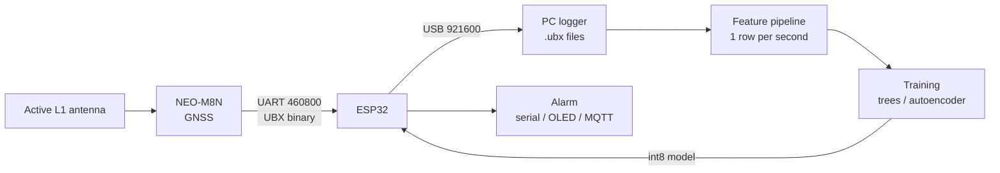

# GNSS-GUARD

Low-cost GPS jamming and spoofing detector. A u-blox NEO-M8N receiver feeds
an ESP32, which extracts signal-quality and consistency
features every second and flags attacks with a small on-device model.

> **Status: data collection phase.** Logging, feature pipeline, attack
> injection and baseline detectors written and tested on synthetic UBX data.
> Receiver bench-tested over direct USB (configuration accepted, RXM-RAWX not
> supported); no real logs yet, waiting on an antenna. No model trained yet.
> See [docs/DATA_COLLECTION.md](docs/DATA_COLLECTION.md).

## Why

GNSS signals arrive at about -130 dBm, weaker than the thermal noise floor,
and civil GPS has no authentication. A few-watt jammer blanks receivers for
kilometres, and a software-defined radio can fake a convincing sky. Both now
happen routinely: aircraft lose GPS over large areas of Eastern Europe and the
Middle East, and ships report positions at inland airports.

Commercial detectors exist for aircraft and timing networks but cost far more
than the receivers they protect. This project asks how much of that detection
a hobby-grade receiver and a ₹400 microcontroller can do, and measures the answer
against the receiver's own built-in flags.

## Threat model

| Attack | What the attacker does | What it looks like at the receiver |
|---|---|---|
| Jamming | Broadband noise on L1 | AGC drops, noise floor rises, C/N0 falls on every satellite, fix lost |
| Meaconing | Records and rebroadcasts the real sky with a delay | Plausible signals, wrong time and position, one antenna geometry |
| Simplistic spoofing | Transmits a fake constellation from scratch | Sudden C/N0 jump, uniform C/N0 across satellites, loss of lock and re-acquisition |
| Drag-off spoofing | Aligns with real signals, then slowly pulls position or time away | Small clock-drift anomalies, C/N0 rising together, slow position drift |

Out of scope: military signals, multi-antenna attackers that reproduce angle of
arrival, and attacks on the corrections or assistance data.

## How it works



Phase 1 (now) uses the ESP32 as a configurator and USB bridge. Phase 3 moves
feature extraction and inference onto the ESP32 itself.

### Detection signals

| Signal | Source | Why it catches attacks |
|---|---|---|
| C/N0 vs elevation correlation | NAV-SAT | Real satellites get stronger higher in the sky; a single spoofer antenna breaks this |
| Common-mode C/N0 change | NAV-SAT | Spoofer power changes move every satellite together |
| C/N0 spread and top-4 mean | NAV-SAT | Spoofed constellations are often unnaturally uniform or strong |
| Pseudorange residuals | NAV-SAT | Inconsistent fake signals do not fit one position solution |
| Clock jump | NAV-CLOCK | Time-push attacks move the clock bias more than its drift explains |
| Position jump | NAV-PVT | Position change not explained by reported velocity |
| AGC, noise floor, jamInd | MON-HW | Jamming raises noise before the fix degrades |
| u-blox `spoofDetState` | NAV-STATUS | Vendor baseline to beat |

Full definitions in [docs/FEATURES.md](docs/FEATURES.md).

## Hardware

| Part | Notes | Approx. cost |
|---|---|---|
| ESP32 DevKit (classic, WROOM-32) | Any classic ESP32 board | ₹400 |
| u-blox NEO-M8N breakout | Multi-GNSS receiver, no IMU | owned |
| Active L1 GNSS antenna, SMA or u.FL | Patch antenna with a few metres of cable | ₹800–1500 |
| Optional: NEO-M8T or ZED-F9P | Raw measurements (RXM-RAWX); F9P adds L2 and stronger built-in detection | ₹4k–25k |
| Optional: NEO-M8U / NEO-M8L | Built-in IMU, a motion reference an attacker cannot spoof | — |

Wiring:

| NEO-M8N | ESP32 |
|---|---|
| TX | GPIO16 (UART2 RX) |
| RX | GPIO17 (UART2 TX) |
| GND | GND |
| VCC | Separate 3.3 V supply, not the ESP32 3V3 pin (see docs/HARDWARE.md) |

Details, UBX message list and mounting notes in
[docs/HARDWARE.md](docs/HARDWARE.md).

## Repository layout

| Path | Contents |
|---|---|
| `firmware/ubx_bridge/` | ESP32 sketch: configures the M8N, bridges UBX to USB |
| `tools/log.py` | Records raw UBX to `data/raw/` with a live status line |
| `tools/features.py` | Converts `.ubx` logs to per-epoch feature CSVs in `data/features/` |
| `tools/configure.py` | Applies the receiver configuration over the receiver's own USB port |
| `tools/inject.py` | Injects labelled synthetic attacks into clean `.ubx` logs, writes `data/synthetic/` |
| `tools/baselines.py` | Baseline detectors B0–B2: fit thresholds on clean data, apply to feature CSVs |
| `tests/` | Feature, injection and baseline tests on synthetic UBX data |
| `docs/` | Hardware, features, data collection, datasets, evaluation |
| `data/raw/` | Raw `.ubx` logs and `.json` sidecars (not committed) |
| `data/features/` | Generated feature CSVs (not committed, regenerable) |
| `data/synthetic/` | Injected attack logs and their label `.json` (not committed, regenerable) |
| `models/` | Trained models and exported headers |

## Quick start

```bash
# Python environment
python3 -m venv .venv
.venv/bin/pip install -r requirements.txt
.venv/bin/pytest

# Flash the bridge (port: /dev/ttyUSB0 or /dev/ttyACM0 on Linux,
# /dev/cu.usbserial-* on macOS, see docs/SETUP.md)
arduino-cli compile --upload -p /dev/ttyUSB0 --fqbn esp32:esp32:esp32 firmware/ubx_bridge

# Record a session
.venv/bin/python tools/log.py --port /dev/ttyUSB0 --scenario clean_static --notes "balcony, clear sky"

# Extract features
.venv/bin/python tools/features.py data/raw/*.ubx
```

The logger prints a `msgs:` line every 5 seconds listing which UBX messages the
receiver is sending. RXM-RAWX is not available: this M8N's firmware NAKs it.

No ESP32 at hand, or no separate 3.3 V supply for the GPS? Plug the receiver's
own USB into the PC and log with `--port /dev/cu.usbmodem* --configure`; see
[docs/HARDWARE.md](docs/HARDWARE.md#direct-usb-logging-no-bridge).

## Documentation

- [Setup](docs/SETUP.md): macOS and Linux toolchain, serial ports, known errors.
- [Hardware](docs/HARDWARE.md): wiring, receiver configuration, UBX messages, mounting.
- [Features](docs/FEATURES.md): every feature, its formula, units and rationale.
- [Data collection](docs/DATA_COLLECTION.md): scenarios, naming, labelling, safety.
- [Datasets](docs/DATASETS.md): TEXBAT, OAKBAT and synthetic attack injection.
- [Evaluation](docs/EVALUATION.md): baselines, metrics and planned experiments.

## Roadmap

- [x] UBX bridge firmware for the NEO-M8N
- [x] Logger and feature pipeline, tested on synthetic data
- [ ] First real logs; confirm which UBX messages the M8N supports
- [ ] 20+ hours of clean data across static, walking and vehicle scenarios
- [ ] Benign degradation set (foliage, urban canyon, antenna blockage)
- [ ] Synthetic attack injection on clean logs (code and tests done, waiting for clean logs)
- [ ] TEXBAT processed through GNSS-SDR into the portable feature set
- [ ] Baselines: u-blox flags, threshold rules (code and tests done, no results yet)
- [ ] Models: gradient-boosted trees, autoencoder trained on clean data only
- [ ] int8 model and feature extraction running on the ESP32
- [ ] Field evaluation: false alarms per hour over long drives
- [ ] Write-up

## Legal note

This project is receive-only. Transmitting on GNSS frequencies, including
jamming or spoofing your own receiver, is illegal in India without WPC
authorisation and in nearly every other country. Attack data comes from
published datasets and software injection, never from transmission.

## License

[Apache License 2.0](LICENSE).
